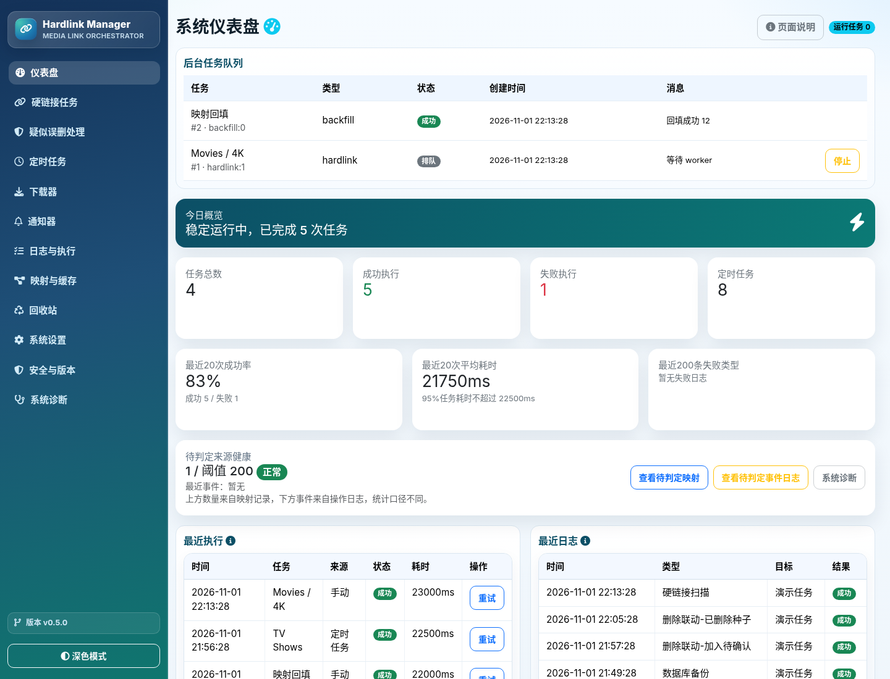
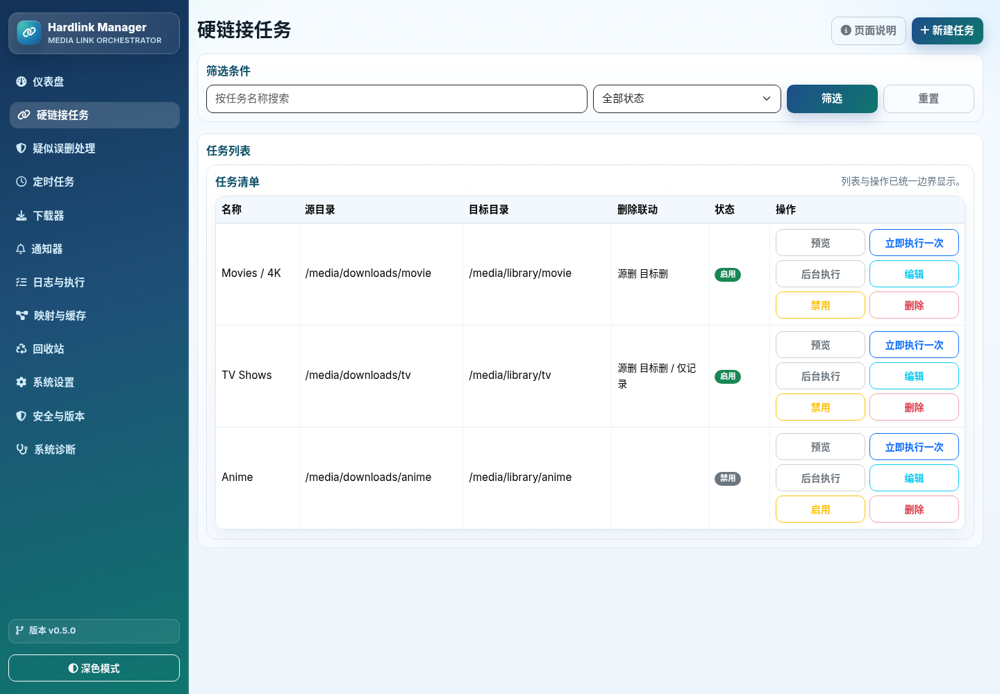
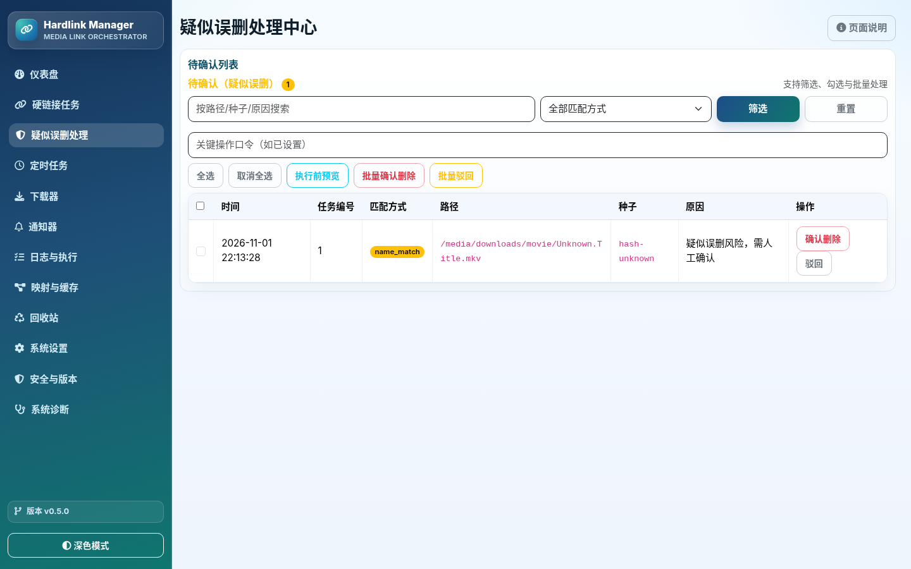
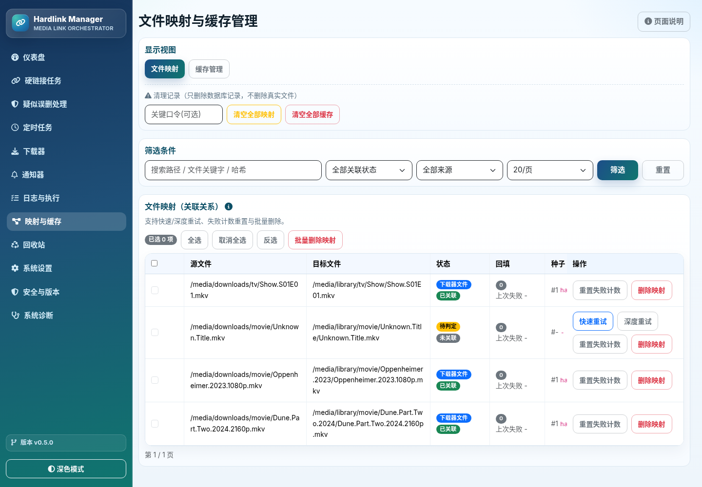
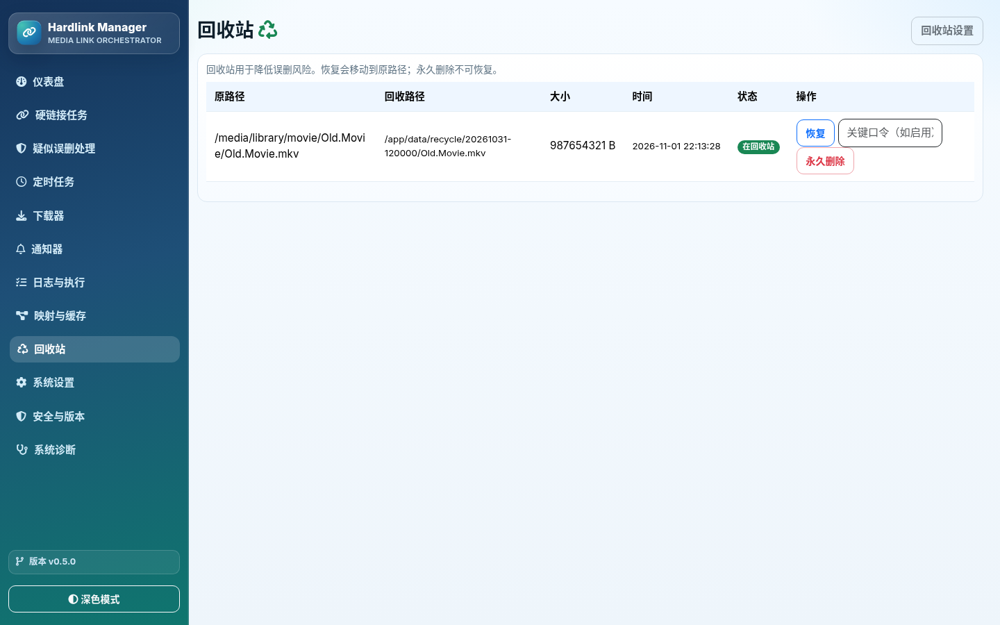
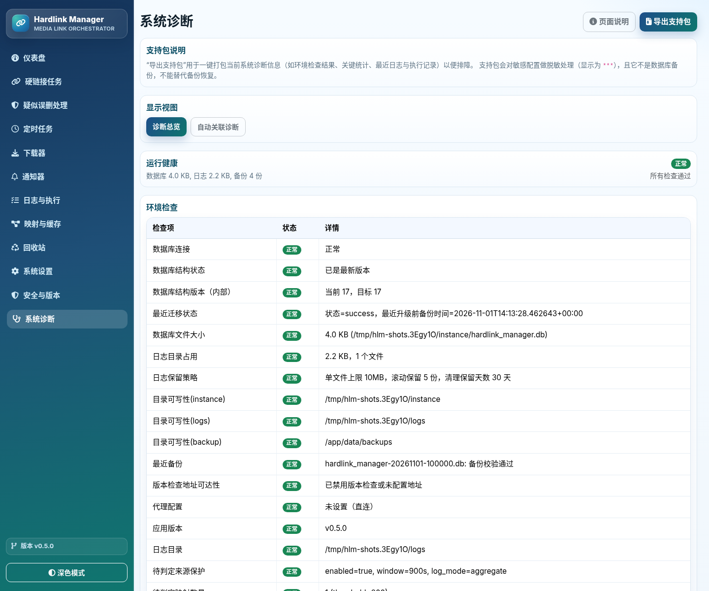
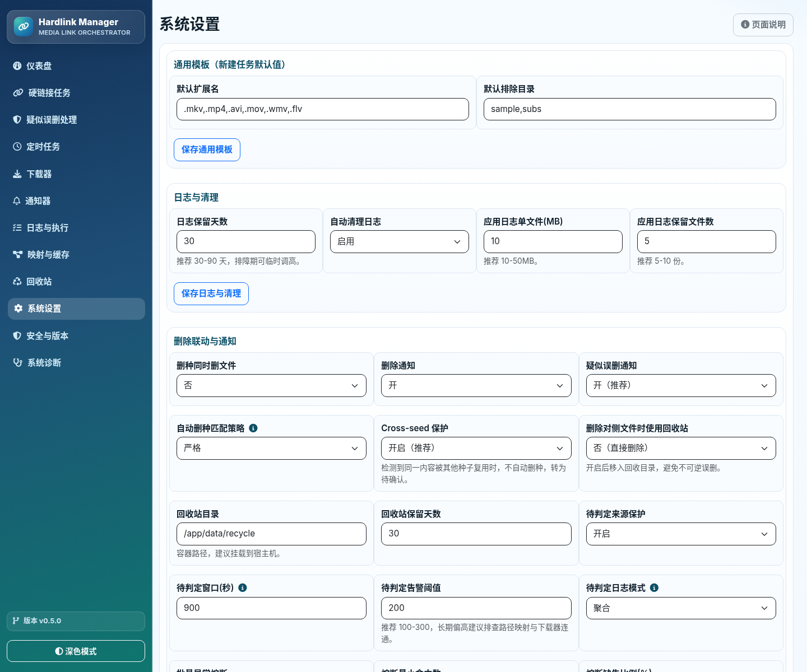

# HLM-Demo 操作指南（v0.5.0）

本文档说明首次初始化、任务配置、删除保护、映射回填、回收站、定时任务、通知和诊断流程。

## 1. 界面预览

### 仪表盘



### 硬链接任务



### 疑似误删处理



### 映射与缓存



### 回收站



### 系统诊断



### 系统设置



## 2. 首次初始化

1. 启动服务后访问 `http://主机IP:5000`。
2. 系统跳转 `/setup`。
3. 读取初始化令牌：

```bash
cat data/instance/setup_token.txt
```

4. 输入令牌、管理员用户名和密码。
5. 登录后进入仪表盘。
6. 建议立即在“安全与版本 -> 管理员安全”启用 TOTP 2FA。

如果明确接受无认证访问，可设置：

```env
HLM_ALLOW_NO_AUTH=true
```

## 3. 仪表盘

仪表盘包含：

- 后台任务队列
- 任务总数、成功/失败执行
- 最近 20 次成功率、平均耗时、P95
- 待判定来源健康
- 最近执行和最近日志

后台任务面板使用 htmx 每 5 秒刷新，支持停止排队/运行中的任务。

## 4. 配置下载器

进入“下载器”：

1. 新增 qBittorrent 连接。
2. 主机填写协议、主机和端口，例如 `http://192.168.1.10`。
3. 端口填写 qB WebUI 端口，例如 `8080`。
4. 可填写分类过滤，例如 `movies`。
5. 保存后可点击“测试”验证连接。

注意：

- 容器内不要写 `127.0.0.1` 访问宿主机服务。
- 如需代理，优先使用下载器独立代理或 `host.docker.internal`。

## 5. 配置通知器

进入“通知器”：

- Telegram：填写机器人令牌和聊天编号。
- Apprise：填写 Apprise URL，例如 Gotify、Discord、Slack 或邮件。
- URL/Token 会加密保存。
- 保存后可点击“测试”。

## 6. 新建硬链接任务

进入“硬链接任务 -> 新建任务”：

1. 填写任务名称。
2. 源目录：容器路径，例如 `/media/downloads/movie`。
3. 目标目录：容器路径，例如 `/media/library/movie`。
4. 填写扩展名和排除目录。
5. 选择是否创建同名目录、是否启用缓存。
6. 配置删除联动：
   - 监控源目录删除
   - 监控目标目录删除
   - 删除冷却秒数
   - 单次最大删除数
   - 删除联动下载器/通知器
   - 是否使用回收站
7. 新任务默认开启“删除联动仅记录不执行（dry-run）”。

## 7. 执行任务

任务列表提供：

- 预览：执行前检查路径和配置。
- 立即执行一次：
  - worker 活跃时自动进入后台队列。
  - 无 worker 时同步执行。
- 后台执行：显式加入队列。
- 编辑、启停、删除。

建议流程：

1. 先预览。
2. 保持 dry-run 执行一次。
3. 查看日志和映射。
4. 确认无误后关闭 dry-run。

## 8. 删除联动

删除联动支持：

- 源删后删除对侧文件。
- 目标删后删除源文件。
- 删除 qB 种子。
- Cross-seed 保护：检测到同内容其他种子时进入待确认。
- 回收站：先移动到回收目录。
- 待确认：弱匹配或风险匹配不自动删种。

进入“疑似误删处理”可以：

- 查看待确认记录。
- 确认删种。
- 驳回。
- 批量确认/驳回。

## 9. 映射与缓存

进入“映射与缓存”：

- 查看源/目标映射。
- 筛选是否已关联种子、来源类型。
- 单条快速重试或深度重试。
- 重置失败计数。
- 删除映射或缓存。
- 批量清理。

重试说明：

- **快速重试**：先按种子名、源文件夹名和路径做轻量候选筛选，适合大多数单文件种子。
- **深度重试**：忽略下载器分类过滤，扫描全部种子文件并比对 `文件名 + 文件大小`；适合多文件种子、历史映射和快速重试失败的情况。种子很多时会比快速重试慢。
- 重试、删除、重置失败计数后，页面会保留当前分页和筛选条件，不会再跳回第一页；筛选条件会同步到地址栏，刷新后仍可恢复。

映射来源：

- `downloader`：已关联下载器种子。
- `manual`：手动来源。
- `pending`：待判定来源。

## 10. 回收站

进入“回收站”：

- 查看被联动删除并移入回收站的文件。
- 恢复到原路径。
- 永久删除（受关键操作口令保护）。
- 移除已恢复记录。

建议：

- 生产环境开启回收站，并挂载 `data/recycle`。
- 设置合理保留天数，例如 30 天。

## 11. 定时任务

进入“定时任务”：

- 新建硬链接扫描计划。
- 配置映射回填。
- 配置日志清理、缓存清理、备份。
- 使用预览确认下一步执行时间。
- 可手动执行一次。

生产环境由独立 `scheduler` 服务运行 cron。

## 12. 系统设置

系统设置包含：

- 通用模板
- 日志清理
- 删除联动与通知
- 来源感知策略
- 网络与通知
- 自动关联
- 备份
- 安全与版本
- 管理员安全
- 可选安全策略

## 13. 安全建议

- 首次初始化必须使用令牌。
- 管理员启用 TOTP 2FA。
- HTTPS 后设置 `SESSION_COOKIE_SECURE=true`。
- 可信反代后设置 `TRUST_PROXY_HEADERS=true`。
- 配置 `allowed_roots`。
- 删除联动先干跑。
- 开启回收站和 cross-seed 保护。
- 不要将 `data/instance` 放在 NFS/SMB。

## 14. 诊断与备份

进入“系统诊断”：

- 查看数据库、日志、备份、schema、目录可写性。
- 导出支持包（脱敏）。
- 查看备份列表。
- 恢复前预览。
- 恢复数据库。

恢复后建议重启容器。

## 15. 截图重新生成

开发环境可用：

```bash
bash scripts/take_screenshots.sh
```

脚本会使用临时数据库启动 gunicorn，使用 headless Chromium 生成：

```text
static/images/screenshots/*.png
```

需要本机安装 `chromium`。

## 16. 版本与更新

- 侧边栏底部显示当前版本号。
- 发现 GitHub 新版本时，版本号右侧会显示提示点，并在当前浏览器会话中提示一次。
- 点击版本号进入“安全与版本”，可查看本地版本、远端版本和上次检查时间。
- “检查更新”会强制刷新版本信息；内网无法访问 GitHub 时可忽略该功能。
- v0.5.0 起“开发与更新”页面已简化为“安全与版本”，不再提供开发模式配置入口。
